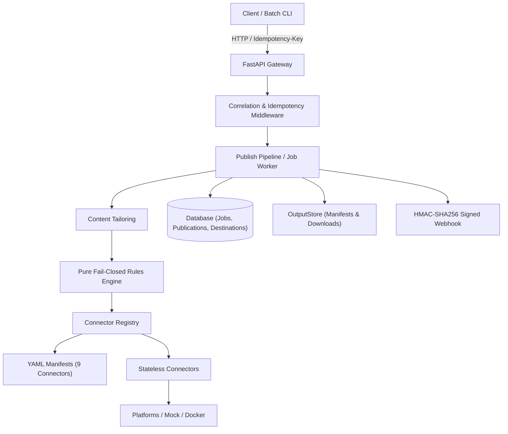

# IncuBrix — Long-Tail Distribution Destination Network

IncuBrix is an enterprise-grade distribution network engine designed to publish, schedule, tailor, and certify content across diverse long-tail platforms (Discourse, Lemmy, Ghost, Dev.to, Hashnode, Kit, MRSS, Webhooks, and Assisted communities).



## Quickstart (< 10 Commands)

```powershell
# 1. Setup virtual environment
python -m venv .venv
.venv\Scripts\Activate.ps1

# 2. Install dependencies
pip install -e ".[test]"

# 3. Run database migrations
alembic upgrade head

# 4. Run the full test suite (104 tests, zero external dependencies required)
pytest

# 5. Start the local server
uvicorn app.main:app --reload --port 8000
```

## Test Suite & Verification

The repository contains 104 automated tests covering foundation, connector contracts, rules engine, publish pipeline, certification, OpenAPI drift, and edge hard cases:

```powershell
# Run all tests
pytest -q

# Run contract tests across all 9 connectors
pytest tests/contract/test_contract.py

# Run fail-closed rules engine and 42-case fixture
pytest tests/test_phase4.py

# Run edge hard cases suite (13 critical scenarios)
pytest tests/test_hard_cases.py

# Run secret scanning and log redaction tests
pytest tests/test_secrets.py
```

## Batch Runner CLI

Run publications in bulk from a folder or file:

```powershell
python -m app.batch --source data/catalogue-150.csv --output-dir outputs/batch-run --api-url http://127.0.0.1:8000
```

## Standard Error Codes

All errors return `{"error": {"code": "...", "message": "...", "retryable": bool, "details": {}}}`:

| Error Code | HTTP Status | Retryable | Description |
|---|---|---|---|
| `REQUEST_INVALID` | 400 | False | Request payload failed schema validation |
| `IDEMPOTENCY_KEY_REQUIRED` | 400 | False | POST request is missing the required `Idempotency-Key` header |
| `IDEMPOTENCY_KEY_INVALID` | 400 | False | `Idempotency-Key` header contains fewer than 8 characters |
| `IDEMPOTENCY_KEY_REUSED` | 409 | False | The key was previously used with a different request payload |
| `DEST_SPEC_VIOLATION` | 400 | False | Rendition exceeds surface limits (e.g. title max chars or forbidden media) |
| `FREQUENCY_CAP` | 422 | False | Blocked by destination posting frequency rules (can be rescheduled) |
| `SELF_PROMOTION_NOT_ALLOWED` | 422 | False | Destination does not allow promotional material |
| `LINK_POLICY_VIOLATION` | 422 | False | Destination forbids external or off-domain links |
| `AI_DISCLOSURE_REQUIRED` | 422 | False | Content is AI-generated and lacks required disclosure marker |
| `AMBIGUOUS_RULE` | 422 | False | Destination rule is missing or ambiguous; system fails closed |
| `CONNECTION_AUTH_EXPIRED` | 401 | False | Stored platform token or webhook credential expired or revoked |
| `PLATFORM_CONTENT_REJECTED` | 422 | False | Platform rejected content formatting or parameters |
| `PLATFORM_RATE_LIMIT` | 429 | True | Platform rate limit reached; honors `Retry-After` header |
| `PLATFORM_UNAVAILABLE` | 503 | True | Platform is down; exponential backoff capped at 5 consecutive retries |
| `PLATFORM_QUOTA_EXHAUSTED` | 429 | False | Platform account quota exhausted |
| `CONNECTOR_DISABLED` | 503 | False | Connector is disabled by administrative kill-switch (`DISABLED_CONNECTORS`) |
| `INTERNAL_ERROR` | 500 | False | Unhandled server error (traceback sanitized from response) |

## Environment Configuration

| Variable | Default | Purpose |
|---|---|---|
| `DATABASE_URL` | `sqlite:///./incubrix.db` | SQLAlchemy connection string |
| `CONNECTOR_MODE` | `simulation` | `simulation`, `mock`, `local`, or `live` |
| `JOB_BACKEND` | `inline` | `inline` (direct execution) or `celery` (distributed queue) |
| `OUTPUT_BACKEND` | `local` | `local` (filesystem) or `s3` (MinIO/AWS S3) |
| `OUTPUT_DIR` | `outputs` | Target directory for generated outputs and manifests |
| `DISABLED_CONNECTORS` | `[]` | Comma-separated list of disabled connector keys (kill-switch) |
| `LOG_LEVEL` | `INFO` | Logging level (`DEBUG`, `INFO`, `WARNING`, `ERROR`) |
